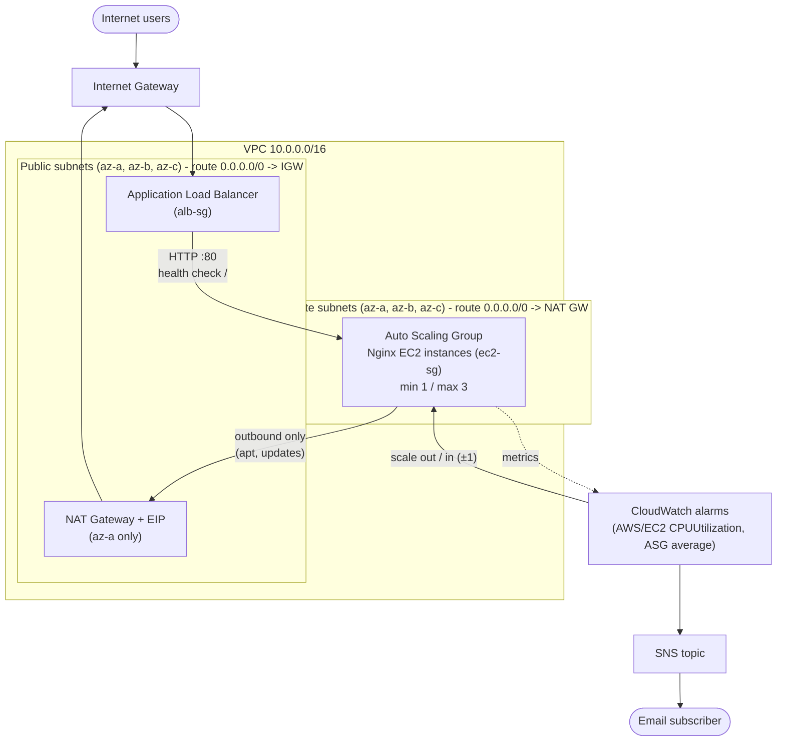
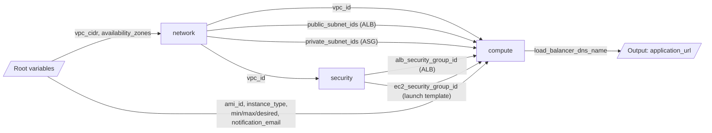

# Auto Scaling Web Tier on AWS (Terraform)

Terraform code for a highly available web tier on AWS. An internet-facing **Application Load Balancer** in public subnets sends HTTP traffic to **Nginx EC2 instances** in private subnets. An **Auto Scaling Group** adds or removes instances when **CloudWatch CPU alarms** fire, and every alarm also notifies an **SNS topic** by email.


---

## Table of contents

- [Features](#features)
- [Architecture](#architecture)
- [Project structure](#project-structure)
- [Modules](#modules)
- [Networking](#networking)
- [Security groups](#security-groups)
- [Auto scaling and alarms](#auto-scaling-and-alarms)
- [IAM](#iam)
- [Getting started](#getting-started)
- [Testing the deployment](#testing-the-deployment)
- [Cost and cleanup](#cost-and-cleanup)
- [Known limitations](#known-limitations)
- [Possible improvements](#possible-improvements)
- [Troubleshooting](#troubleshooting)

---

## Features

- **Modular design**: three reusable modules (`network`, `security`, `compute`) wired together in the root module.
- **Multi-AZ**: 3 public and 3 private subnets spread across 3 Availability Zones.
- **Private instances**: EC2 instances have no public IP and are only reachable through the ALB.
- **Least-privilege network access**: instances accept HTTP only from the ALB's security group (SG-to-SG reference).
- **CPU-based auto scaling**: scale out at ≥ 70% CPU, scale in at ≤ 40% CPU, between 1 and 3 instances.
- **Email alerts**: every scaling alarm publishes to SNS, which emails the configured address.

---

## Architecture



<details>
<summary>ASCII version (for viewers without Mermaid support)</summary>

```
                         Internet
                            │
                     ┌──────▼──────┐
                     │     IGW     │
                     └──────┬──────┘
┌───────────────────────────┼──────────────── VPC 10.0.0.0/16 ───────────┐
│  PUBLIC subnets (rt: 0.0.0.0/0 -> IGW)                                 │
│  10.0.0.0/24 (az-a)   10.0.1.0/24 (az-b)   10.0.2.0/24 (az-c)          │
│  ┌──────────────── ALB (alb-sg) ────────────────┐   ┌───────────────┐  │
│  └───────────────────┬──────────────────────────┘   │ NAT GW + EIP  │  │
│                      │ HTTP :80                     │  (az-a only)  │  │
│                      │ (target group, health /)     └───────▲───────┘  │
│  PRIVATE subnets (rt: 0.0.0.0/0 -> NAT GW)                  │ outbound │
│  10.0.3.0/24 (az-a)   10.0.4.0/24 (az-b)   10.0.5.0/24 (az-c)          │
│  ┌───────────────────▼────────────────────────────┐         │          │
│  │ ASG: EC2 Nginx instances (ec2-sg), min 1–max 3 │─────────┘          │
│  └────────────────────────────────────────────────┘                    │
└────────────────────────────────────────────────────────────────────────┘
 CloudWatch (AWS/EC2 CPU, ASG avg) ─alarm─► scaling policy ±1 ─► ASG
                                    └─────► SNS topic ─► email
```

</details>

### Request flow

1. A user opens the ALB DNS name in a browser.
2. The request enters through the Internet Gateway and reaches the ALB in a public subnet.
3. The ALB listener forwards it on port 80 to a healthy instance in the target group.
4. Nginx on the instance (in a private subnet) answers; the reply goes back through the ALB.

---

## Project structure

```
.
├── main.tf              # Root module: wires network -> security -> compute
├── versions.tf          # Terraform and provider version constraints
├── variables.tf         # Root input variables
├── outputs.tf           # Root outputs (application_url, ...)
├── terraform.tfvars     # Your overrides (region, AZs, email, ...)
└── modules/
    ├── network/         # VPC, subnets, IGW, NAT GW, route tables
    ├── security/        # ALB and EC2 security groups
    └── compute/         # ALB, target group, launch template, ASG, alarms, SNS
        └── user_data.sh # Installs Nginx on boot
```

> Adjust this tree if your file layout differs.

---

## Modules

| Module | Creates | Key inputs | Key outputs |
|---|---|---|---|
| `network` | VPC, IGW, 3 public + 3 private subnets, 2 route tables, EIP, 1 NAT GW | `vpc_cidr`, `availability_zones`, `name_prefix` | `vpc_id`, `public_subnet_ids`, `private_subnet_ids` |
| `security` | ALB SG, EC2 SG | `vpc_id`, `name_prefix` | `alb_security_group_id`, `ec2_security_group_id` |
| `compute` | ALB, target group, listener, launch template, ASG, 2 scaling policies, 2 CloudWatch alarms, SNS topic (+ email subscription) | subnet IDs, SG IDs, `ami_id`, `instance_type`, min/max/desired capacity, `notification_email` | `load_balancer_dns_name`, `autoscaling_group_name`, alarm names, `notification_topic_arn` |

### How the modules connect

The root [`main.tf`](main.tf) passes outputs from one module into the next. Terraform works out the creation order from these references, so no `depends_on` is needed.



Inside `compute`:
- **Traffic path:** ALB → listener → target group ← ASG (attached via `target_group_arns`).
- **Scaling path:** CloudWatch alarms → scaling policies (and SNS for notifications).

---

## Networking

| Subnet tier | Default CIDRs | `cidrsubnet(vpc_cidr, 8, n)` | Default route | Purpose |
|---|---|---|---|---|
| Public | `10.0.0.0/24`, `10.0.1.0/24`, `10.0.2.0/24` | n = 0–2 | `0.0.0.0/0` → IGW | Hosts the ALB and NAT GW; public IPs auto-assigned |
| Private | `10.0.3.0/24`, `10.0.4.0/24`, `10.0.5.0/24` | n = 3–5 | `0.0.0.0/0` → NAT GW | Hosts the instances; no public IPs, not reachable from the internet |

Key points:

- **Inside the VPC:** traffic within `10.0.0.0/16` uses the implicit `local` route in both route tables.
- **Inbound:** Internet → IGW → ALB → instance. Instances are never exposed directly.
- **Outbound:** instance → NAT GW (public subnet) → IGW. Used for `apt` and updates. NAT only allows connections that start from inside.
- **Route tables:** one shared table per tier, not one per AZ.
- **NAT Gateway:** a single NAT GW in the first AZ. This saves cost, but if that AZ fails, instances in all AZs lose outbound internet access (inbound traffic through the ALB keeps working).

---

## Security groups

Security groups are **stateful**: replies to allowed inbound traffic are allowed out automatically.

| SG | Attached to | Inbound | Outbound | Purpose |
|---|---|---|---|---|
| `<prefix>-alb-sg` | ALB | TCP 80 and 443 from `0.0.0.0/0` | All traffic to `0.0.0.0/0` | Public entry point |
| `<prefix>-ec2-sg` | ASG instances (via launch template) | TCP 80 **from `alb-sg` only** | All traffic to `0.0.0.0/0` (through NAT) | Only the ALB can reach instances; outbound for package installs |

### Why an SG-to-SG reference?

`ec2-sg` allows traffic from `security_groups = [alb-sg]` instead of a CIDR range. Any resource carrying `alb-sg` is allowed, whatever its IP address. This:

- keeps working when the ALB's IPs change across AZs, and
- blocks everything else, including other resources inside the VPC, from reaching port 80 on the instances.

---

## Auto scaling and alarms

| Setting | Value |
|---|---|
| Metric | `AWS/EC2` `CPUUtilization`, average across the ASG |
| Scale out | CPU **≥ 70%** for 2 periods of 60 s → **+1 instance** |
| Scale in | CPU **≤ 40%** for 2 periods of 60 s → **−1 instance** |
| Cooldown | 300 s |
| Capacity | min 1, max 3 |
| Health check | ALB target group, HTTP on path `/` |
| Notifications | Both alarms publish to the SNS topic → email |

> These thresholds are **hardcoded** in the `compute` module, not exposed as variables. Edit the module to change them.

---

## IAM

No IAM roles, policies or instance profiles are defined. This means:

- Instances **cannot call AWS APIs**.
- **No SSM Session Manager** access.
- **No SSH**: the launch template sets no key pair.

CloudWatch alarms trigger the scaling policies and publish to SNS through AWS service-linked mechanisms, so no explicit IAM is needed for scaling or alerts.

---

## Getting started

### Prerequisites

- [Terraform](https://developer.hashicorp.com/terraform/install) `>= 1.6, < 2.0`
- AWS provider `~> 6.0` (installed by `terraform init`, see [`versions.tf`](versions.tf))
- AWS credentials (CLI profile or environment variables) with permissions for **VPC, EC2/Auto Scaling, ELB, CloudWatch and SNS**

### Defaults

| Setting | Default |
|---|---|
| Region | `eu-north-1` |
| Availability Zones | `eu-north-1a`, `eu-north-1b`, `eu-north-1c` |
| AMI | Ubuntu 22.04 (region-specific ID) |
| VPC CIDR | `10.0.0.0/16` |

> **Changing region?** Update the AZs **and** the AMI ID too: AMI IDs are different in every region. Exactly **3 AZs** are required.

### 1. Configure variables

Create or edit `terraform.tfvars`. Check [`variables.tf`](variables.tf) for the exact variable names and defaults.

```hcl
availability_zones = ["eu-north-1a", "eu-north-1b", "eu-north-1c"]
ami_id             = "ami-xxxxxxxxxxxxxxxxx" # Ubuntu 22.04 in your region
instance_type      = "t3.micro"
notification_email = "you@example.com"       # or "" to disable email alerts
```

> ⚠️ The default `notification_email` is a personal address. **Set your own** (or `""`) before applying. After apply, the recipient must click the confirmation link in the SNS email, or no alerts will arrive.

### 2. Deploy

```bash
terraform init
terraform fmt -check
terraform validate
terraform plan -out tfplan
terraform apply tfplan
```

### 3. Open the application

```bash
terraform output application_url
```

Open the URL in a browser. New instances may need a minute or two to install Nginx and pass the health check.

### State

There is no `backend` block, so state is stored **locally** in `terraform.tfstate`. That is fine for a personal lab, but not for teams: use a remote backend (for example S3 with state locking) for shared work.

---

## Testing the deployment

| Check | How |
|---|---|
| App is up | Open `application_url`; you should see the Nginx page |
| Targets are healthy | EC2 console → Target Groups → **Targets** tab shows `healthy` |
| Instances are private | EC2 console: instances have no public IPv4 address |
| Direct access is blocked | Instances have no public IP, and `ec2-sg` only accepts traffic from the ALB |
| Alarms exist | CloudWatch → Alarms: two alarms for the ASG |
| Email works | Confirm the SNS subscription, then watch for alarm emails |

**Testing scale-out:** instances have no SSH or SSM access, so you can't run a CPU stress tool on them directly. Options:
- Send heavy load to the ALB from outside (for example with `hey` or `ab`). A default Nginx page is light, so CPU may not reach 70%.
- Temporarily lower the scale-out threshold in the `compute` module, apply, and watch the ASG activity history.
- Add an IAM instance profile with SSM access (see [Possible improvements](#possible-improvements)), then run a stress tool through Session Manager.

---

## Cost and cleanup

This stack is **not free**. The main ongoing costs are:

- **NAT Gateway**: billed per hour plus per GB processed
- **Application Load Balancer**: billed per hour plus capacity units
- **Elastic IP** attached to the NAT GW
- **EC2 instances** (1–3, depending on load)

Destroy everything when you're done:

```bash
terraform destroy
```

---

## Known limitations

- **Single NAT Gateway**: one point of failure for outbound traffic.
- **HTTP only**: port 443 is open on the ALB, but there is no HTTPS listener or certificate, so the rule does nothing.
- **Wide ALB egress**: ALB outbound allows all traffic; it could be limited to `ec2-sg` on port 80.
- **No instance access**: no IAM role, no SSM, no SSH key, so debugging a running instance is hard.
- **Hardcoded scaling settings**: thresholds and cooldown can't be changed through variables.
- **Local state**: not suitable for team use.
- **Fixed AZ count**: exactly 3 AZs are required.

---

## Possible improvements

- [ ] One NAT Gateway per AZ (with per-AZ private route tables) for high availability
- [ ] HTTPS listener with an ACM certificate, plus HTTP → HTTPS redirect
- [ ] Limit ALB egress to `ec2-sg` on port 80
- [ ] IAM instance profile with `AmazonSSMManagedInstanceCore` for Session Manager access
- [ ] Expose scaling thresholds, periods and cooldown as variables
- [ ] Consider a target tracking policy (for example average CPU at 50%) instead of step alarms
- [ ] Remote state backend (S3 with locking)
- [ ] Look up the AMI with a `data "aws_ami"` block instead of a hardcoded ID
- [ ] Remove the personal default for `notification_email`

---

## Troubleshooting

| Symptom | Likely cause | Fix |
|---|---|---|
| ALB returns **502/503** | Instances still booting, or Nginx failed to install | Wait a few minutes; check target health. Review `user_data.sh` |
| Targets stay **unhealthy** | Nginx not listening on port 80, or `/` not returning 200 | Check `user_data.sh` and the target group health check settings |
| Instances can't install packages | NAT GW or private route table problem | Check the private route table has `0.0.0.0/0` → NAT GW |
| `InvalidAMIID` error on apply | AMI ID doesn't exist in the selected region | Use an Ubuntu 22.04 AMI ID for your region |
| AZ errors on apply | AZ names don't match the region, or not exactly 3 | Set 3 valid AZs for your region |
| No alarm emails | SNS subscription not confirmed | Click the link in the confirmation email |

---

## Notes and assumptions

- Nginx is installed by [`modules/compute/user_data.sh`](modules/compute/user_data.sh). That script has not been reviewed as part of this README.
- Free-tier eligibility for the region, AZs and instance type has not been verified.
