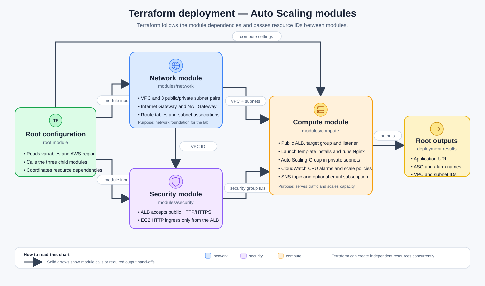
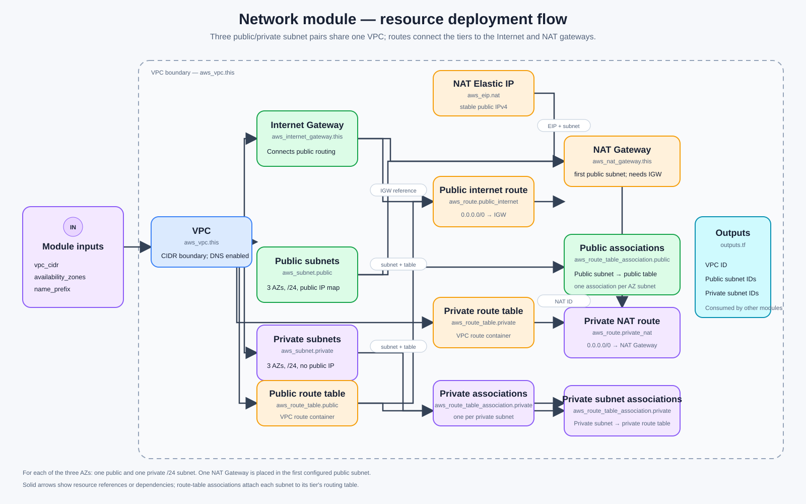
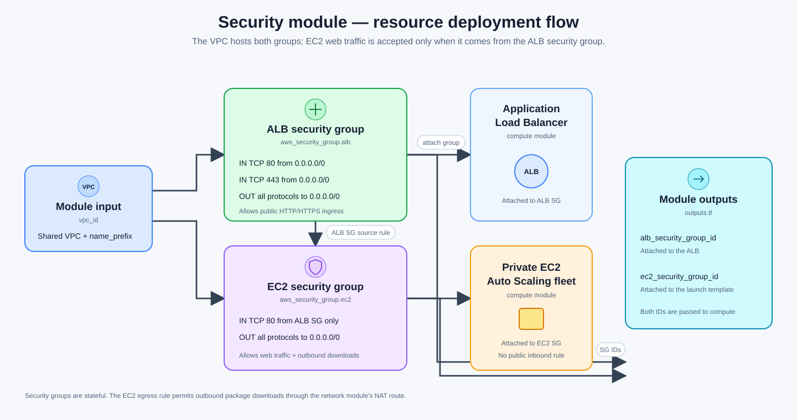
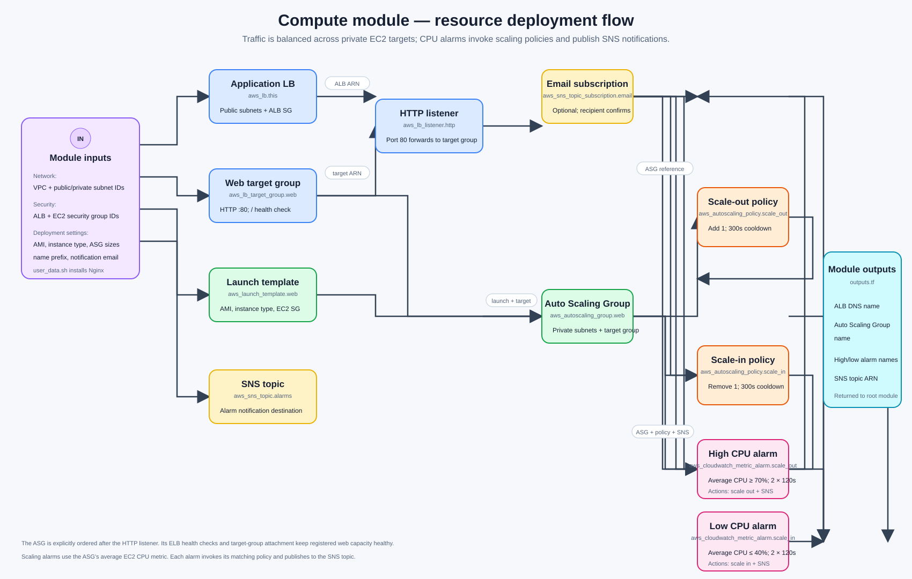
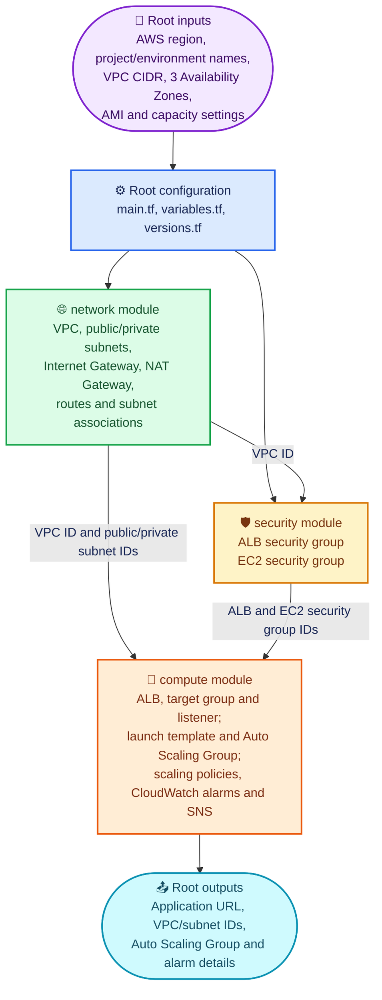

# Auto Scaling Deployment Flow

This chart explains how the root Terraform configuration deploys the modules and
how the resulting AWS resources work together. Terraform creates resources from
their dependencies; the modules do not need to be applied manually one at a
time.

## Detailed module resource charts

Each chart follows the same color and symbol style as the overview and names
the Terraform resources, their purpose, and the key references between them.

### Network module

### Security module

### Compute module

## Terraform deployment order

### What each part is for

| Part | Purpose | Key hand-off |
|---|---|---|
| Root configuration | Collects deployment settings, sets the AWS provider and calls the modules. It defines the dependency graph Terraform uses during `terraform apply`. | Sends shared naming and configuration values to the modules. |
| `network` module | Builds the VPC and three public/private subnet pairs. Public subnets route to the Internet Gateway for the load balancer; private subnets route outbound through one NAT Gateway. | Exports the VPC ID and subnet IDs. |
| `security` module | Creates separate network rules: the ALB accepts public HTTP/HTTPS, while EC2 instances accept HTTP only from the ALB security group. | Exports the ALB and EC2 security group IDs. |
| `compute` module | Creates the internet-facing ALB and HTTP listener, the EC2 launch template and Auto Scaling Group, CPU-based scaling policies/alarms, and an SNS alarm topic with an optional email subscription. | Exports the ALB DNS name, Auto Scaling Group name, alarm names and SNS topic ARN. |
| Root outputs | Makes useful deployment results available after Terraform finishes. | For example, `application_url` gives the public HTTP URL. |

The `compute` module consumes both the network and security outputs. Terraform
therefore creates the VPC before its security groups, and waits for the network
and security inputs before creating dependent compute resources. Independent
resources may be created concurrently.

## Request and scaling flow

```mermaid
flowchart LR
    User(["👤 Web user"]) -->|"HTTP :80"| ALB["🌍 Public Application Load Balancer<br/>in public subnets"]
    ALB -->|"Forwards to healthy targets"| TG["🎯 Target group<br/>HTTP :80 health checks"]
    TG --> EC2["🖥️ Nginx EC2 instances<br/>in private subnets"]
    EC2 -.->|"Outbound internet via NAT"| NAT["🔀 NAT Gateway<br/>in a public subnet"]

    EC2 --> Metrics["📊 CloudWatch<br/>average ASG CPU"]
    Metrics -->|"At least 70% for 2 x 120-second periods"| High["🔺 High CPU alarm"]
    Metrics -->|"At most 40% for 2 x 120-second periods"| Low["🔻 Low CPU alarm"]
    High -->|"Add 1 instance"| Out["➕ Scale-out policy"]
    Low -->|"Remove 1 instance"| In["➖ Scale-in policy"]
    Out --> ASG["🔄 Auto Scaling Group<br/>minimum 1, desired 1, maximum 3 by default"]
    In --> ASG
    ASG -->|"Maintains instances and registers targets"| EC2
    High -->|"Alarm notification"| SNS["🔔 SNS topic"]
    Low -->|"Alarm notification"| SNS
    SNS -->|"Only when notification_email is set<br/>and the recipient confirms"| Email(["✉️ Email subscriber"])

    classDef user fill:#f3e8ff,stroke:#7e22ce,color:#3b0764,stroke-width:2px
    classDef public fill:#dbeafe,stroke:#2563eb,color:#172554,stroke-width:2px
    classDef target fill:#e0e7ff,stroke:#4f46e5,color:#312e81,stroke-width:2px
    classDef private fill:#dcfce7,stroke:#16a34a,color:#14532d,stroke-width:2px
    classDef nat fill:#fef3c7,stroke:#d97706,color:#78350f,stroke-width:2px
    classDef monitor fill:#fce7f3,stroke:#db2777,color:#831843,stroke-width:2px
    classDef high fill:#fee2e2,stroke:#dc2626,color:#7f1d1d,stroke-width:2px
    classDef low fill:#dbeafe,stroke:#2563eb,color:#172554,stroke-width:2px
    classDef policy fill:#ffedd5,stroke:#ea580c,color:#7c2d12,stroke-width:2px
    classDef asg fill:#ccfbf1,stroke:#0f766e,color:#134e4a,stroke-width:2px
    classDef notify fill:#fef3c7,stroke:#d97706,color:#78350f,stroke-width:2px
    class User,Email user
    class ALB public
    class TG target
    class EC2 private
    class NAT nat
    class Metrics monitor
    class High high
    class Low low
    class Out,In policy
    class ASG asg
    class SNS notify
```

## Notes

- The launch template runs `modules/compute/user_data.sh`, which installs and
  starts Nginx on each instance.
- The ALB health check uses `/` over HTTP and forwards traffic only to healthy
  targets.
- The security group permits public HTTPS ingress, but this configuration has
  only an HTTP listener; it does not configure a TLS certificate or HTTPS
  listener.
- The NAT Gateway is deployed in the first configured Availability Zone. It
  provides private-subnet outbound internet access, not inbound access to the
  EC2 instances.
- The example capacity values in the chart are defaults; override
  `min_size`, `desired_capacity` or `max_size` with Terraform variables as
  needed.
