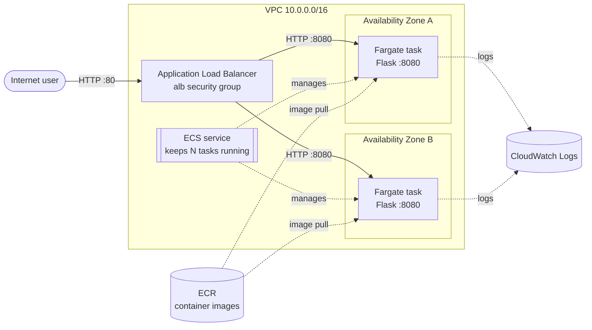

# ECS Fargate on AWS with Terraform


A small, modular Terraform project that deploys a containerised web application on **Amazon ECS with AWS Fargate**, behind an **Application Load Balancer**, with rolling deployments, automatic rollback and CPU-based auto scaling.

It is designed for learning and for use as a starting template. Each AWS concern lives in its own module, so you can read, reuse or replace pieces independently.

---

## Table of contents

1. [What you get](#what-you-get)
2. [Architecture](#architecture)
3. [Project structure](#project-structure)
4. [Prerequisites](#prerequisites)
5. [Quick start](#quick-start)
6. [Verify the deployment](#verify-the-deployment)
7. [Deploy a new version](#deploy-a-new-version)
8. [Test auto scaling](#test-auto-scaling)
9. [Configuration reference](#configuration-reference)
10. [Modules](#modules)
11. [Cost](#cost)
12. [Clean up](#clean-up)
13. [Troubleshooting](#troubleshooting)
14. [Design decisions and production hardening](#design-decisions-and-production-hardening)

---

## What you get

- A **VPC** with two public subnets in different Availability Zones
- A private **ECR** repository (immutable tags, scan on push, lifecycle cleanup)
- An **Application Load Balancer** with a health-checked target group
- An **ECS cluster**, task definition and **service** running on Fargate (no servers to manage)
- **Rolling deployments** with a **circuit breaker** that rolls back failed releases automatically
- **Auto scaling** on average CPU utilisation (2 to 6 tasks by default)
- **CloudWatch** logs and Container Insights metrics
- A tiny Flask sample app, so you can see load balancing and deployments working

## Architecture



**Traffic flow:** users reach the load balancer on port 80. The load balancer forwards requests to healthy tasks on port 8080. The task security group accepts traffic **only from the load balancer's security group**, so containers cannot be reached directly from the internet.

**Key concepts**

| Concept | Role in this project |
|---|---|
| Task definition | Blueprint for one running copy of the app: image, CPU, memory, port, logging |
| Task | One running copy of the task definition |
| Service | Keeps the desired number of tasks running, replaces failed ones, performs rolling updates |
| Cluster | Logical grouping of services. With Fargate there are no instances to manage |
| Task execution role | Lets ECS pull the image from ECR and write logs. It is not used by your application code |

## Project structure

```text
.
├── main.tf                  # Wires the modules together
├── variables.tf             # Root input variables
├── outputs.tf               # Root outputs (app URL, ECR URL, ...)
├── providers.tf             # AWS provider and default tags
├── versions.tf              # Terraform and provider version constraints
├── terraform.tfvars.example # Example configuration
├── modules/
│   ├── networking/          # VPC, public subnets, internet gateway, routes
│   ├── ecr/                 # Container registry
│   ├── alb/                 # Load balancer, target group, listener, security group
│   └── ecs/                 # Cluster, task definition, service, IAM, logs, auto scaling
├── app/                     # Sample Flask application and Dockerfile
└── scripts/
    └── push-image.sh        # Build and push an image to ECR
```

## Prerequisites

| Tool | Version | Purpose |
|---|---|---|
| [Terraform](https://developer.hashicorp.com/terraform/install) | 1.5 or newer | Provisions the infrastructure |
| [AWS CLI](https://docs.aws.amazon.com/cli/latest/userguide/getting-started-install.html) | v2 | Authentication and ECR login |
| [Docker](https://docs.docker.com/get-docker/) with Buildx | recent | Builds the container image |

You also need an AWS account and credentials configured (`aws configure` or SSO) with permission to create VPC, ECR, ELB, ECS, IAM, CloudWatch and Application Auto Scaling resources. Check that you are using the account you expect:

```bash
aws sts get-caller-identity
```

## Quick start

The ECS service needs an image to run, and the ECR repository must exist before you can push one. The deployment therefore has **three steps**.

### 1. Configure

```bash
cp terraform.tfvars.example terraform.tfvars
# edit terraform.tfvars if you want a different region, name or access rules
terraform init
```

### 2. Create the registry and push the first image

```bash
terraform apply -target=module.ecr
./scripts/push-image.sh v1
```

The script reads the repository URL from Terraform, logs in to ECR, builds the image for `linux/amd64` and pushes it with the tag you give it.

### 3. Create everything else

```bash
terraform plan
terraform apply
```

When it finishes (around 3 to 5 minutes), Terraform prints the outputs:

```text
app_url = "http://demo-api-dev-alb-1234567890.eu-central-1.elb.amazonaws.com"
```

## Verify the deployment

```bash
curl "$(terraform output -raw app_url)"
```

Expected response:

```json
{"host": "ip-10-0-1-23.eu-central-1.compute.internal", "message": "Hello from ECS Fargate", "version": "v1"}
```

Run the command several times. The `host` value alternates between the two tasks, which shows the load balancer is distributing traffic. You can also check the service in the AWS Console under **ECS > Clusters > demo-api-dev-cluster**.

## Deploy a new version

1. Change something in `app/app.py` (for example the `message`).
2. Build and push a new tag. Tags are immutable, so every release needs a new one:

   ```bash
   ./scripts/push-image.sh v2
   ```

3. Set `image_tag = "v2"` in `terraform.tfvars` and apply:

   ```bash
   terraform apply
   ```

ECS starts new tasks, waits for them to pass health checks, then drains and stops the old ones. At no point are fewer than the desired number of tasks healthy.

**Try a failed deployment.** Set `image_tag` to a tag that does not exist (for example `v99`) and apply. The new tasks cannot start, the **deployment circuit breaker** trips and ECS rolls back to the last working version. You will see the reason in the service's **Events** tab. Afterwards, set `image_tag` back to a valid value so Terraform and AWS agree again.

## Test auto scaling

The service scales between `min_capacity` and `max_capacity` to keep average CPU near 50%. The sample app has a `/burn` endpoint that uses CPU on purpose.

```bash
URL="$(terraform output -raw app_url)"
for i in $(seq 1 8); do
  (while true; do curl -s "$URL/burn" > /dev/null; done) &
done
# Watch the running task count rise in the ECS console (allow a few minutes)
# Stop the load:
kill $(jobs -p)
```

After the load stops, the service scales back in more slowly than it scaled out. This is intentional.

## Configuration reference

All inputs are set in `terraform.tfvars`. Every variable has a default.

| Variable | Description | Default |
|---|---|---|
| `aws_region` | AWS region | `eu-central-1` |
| `project` | Name prefix for resources (lowercase, no spaces) | `demo-api` |
| `environment` | Environment label, for example `dev` | `dev` |
| `image_tag` | Image tag in ECR to deploy | `v1` |
| `container_port` | Port the app listens on | `8080` |
| `vpc_cidr` | VPC address range | `10.0.0.0/16` |
| `allowed_cidr_blocks` | Who may reach the load balancer on port 80 | `["0.0.0.0/0"]` |
| `task_cpu` | Task CPU units (256 = 0.25 vCPU) | `256` |
| `task_memory` | Task memory in MB | `512` |
| `desired_count` | Initial number of tasks | `2` |
| `min_capacity` | Auto scaling minimum | `2` |
| `max_capacity` | Auto scaling maximum | `6` |

Fargate only accepts specific CPU and memory pairs. For example, 256 CPU supports 512, 1024 or 2048 MB. See the [AWS documentation](https://docs.aws.amazon.com/AmazonECS/latest/developerguide/task-cpu-memory-error.html) for the full table.

**Outputs:** `app_url`, `ecr_repository_url`, `ecs_cluster_name`, `ecs_service_name`, `log_group_name`.

## Modules

| Module | Responsibility | Key inputs | Key outputs |
|---|---|---|---|
| [`networking`](modules/networking) | VPC, public subnets across AZs, internet gateway, route table | `name`, `vpc_cidr`, `az_count` | `vpc_id`, `public_subnet_ids` |
| [`ecr`](modules/ecr) | Private image repository with scanning and lifecycle policy | `name`, `max_image_count` | `repository_url` |
| [`alb`](modules/alb) | Load balancer, security group, IP target group, HTTP listener | `vpc_id`, `subnet_ids`, `target_port`, `health_check_path` | `dns_name`, `security_group_id`, `target_group_arn` |
| [`ecs`](modules/ecs) | Cluster, task definition, service, execution role, task security group, logs, auto scaling | `image`, `subnet_ids`, `target_group_arn`, `alb_security_group_id` | `cluster_name`, `service_name` |

Dependencies flow in one direction: `networking` feeds `alb` and `ecs`, and `alb` feeds `ecs`. The `ecr` module is independent, which is why it can be created first.

## Cost

This project creates billable resources. The main costs are the **Application Load Balancer** (hourly plus usage) and the **Fargate tasks** (per vCPU and GB per second while running). Logs and ECR storage are small for a demo.

Destroy the environment when you are not using it. See [Clean up](#clean-up). Current prices are on the [AWS pricing pages](https://aws.amazon.com/fargate/pricing/).

## Clean up

```bash
terraform destroy
```

This removes everything, including the ECR repository and its images (`force_delete` is enabled for convenience in practice environments). If you ran with a custom state location, make sure you are in the same workspace.

## Troubleshooting

| Symptom | Likely cause and fix |
|---|---|
| Tasks stop immediately with `CannotPullContainerError` | The image tag does not exist in ECR, or tasks cannot reach ECR. Check `image_tag` and that `assign_public_ip` is enabled when using public subnets |
| `exec format error` in the logs | Image built for the wrong CPU architecture (common on Apple Silicon). Use `push-image.sh`, which builds for `linux/amd64` |
| Load balancer targets show `unhealthy` | Check that the app serves `/health` with HTTP 200 and that the task security group allows the app port from the load balancer |
| `curl` to the URL times out | The load balancer takes a minute or two to become active. Also check `allowed_cidr_blocks` includes your IP |
| `terraform apply` fails with `RepositoryNotFound` or image errors on first run | You skipped step 2. Create the ECR repository and push an image first |
| Deployment rolled back | Open the service **Events** tab in the console, and the log group `/ecs/<project>-<environment>` in CloudWatch |

Useful commands:

```bash
aws ecs describe-services --cluster demo-api-dev-cluster --services demo-api-dev-svc \
  --query 'services[0].events[:5].message'
aws logs tail /ecs/demo-api-dev --follow
```

## Design decisions and production hardening

This project favours clarity and low cost. Before using it for a real workload, consider these changes:

- **Private subnets.** Tasks run in public subnets with public IPs so they can pull images without a NAT gateway. For production, place tasks in private subnets and use a NAT gateway or VPC endpoints (ECR, S3, CloudWatch Logs).
- **HTTPS.** The listener serves plain HTTP. Add an ACM certificate, an HTTPS listener on 443 and a redirect from 80.
- **Remote state.** State is local by default. Enable the S3 backend shown in `versions.tf` for team use, with locking.
- **Task role and secrets.** Add a task role if the app calls AWS APIs, and inject secrets from Secrets Manager or SSM Parameter Store through the `secrets` field of the container definition.
- **Image immutability.** Tags are immutable by design, so each release gets a unique tag. In CI/CD, use the git commit SHA as the tag.
- **Auto scaling ownership.** The service ignores changes to `desired_count` so Terraform does not fight auto scaling. Change capacity through `min_capacity` and `max_capacity`.
- **Alarms.** Add CloudWatch alarms on 5xx responses, unhealthy hosts and task count.

## License

MIT. Replace this section with the licence you prefer before publishing.
