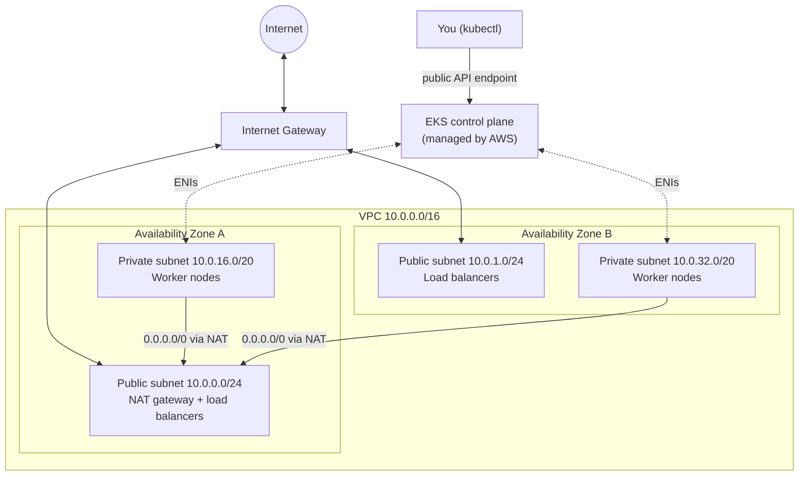
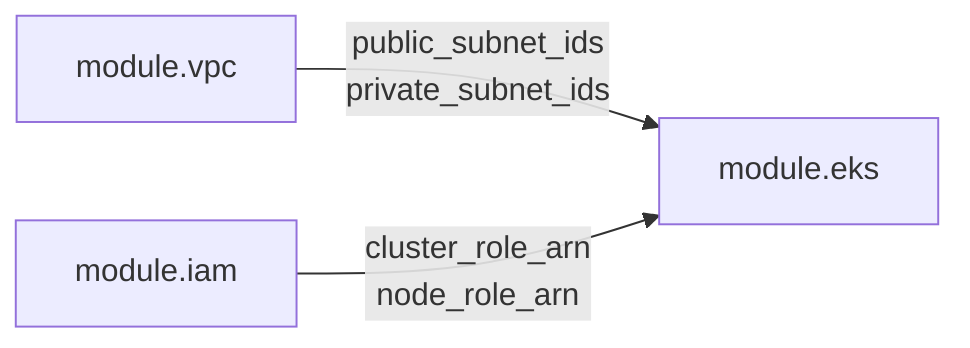

# Amazon EKS with Terraform modules: public + private subnets and NAT gateway

A modular Terraform project that builds a production-style Amazon EKS cluster:

- A VPC with **public** and **private** subnets across 2 Availability Zones
- Elastic Network Interfaces (ENIs) connect your control plane, worker nodes, and pods to your Amazon VPC network
- **One NAT gateway**, so worker nodes in private subnets can reach the internet without being exposed
- An **EKS cluster** (Standard support, API authentication mode with access entries)
- Managed add-ons: **VPC CNI**, **kube-proxy**, **CoreDNS**
- A **managed node group** of EC2 worker nodes in the private subnets
- Optional **access entries** to give other IAM users or roles access to the cluster

The code is split into three reusable local modules (`vpc`, `iam` and `eks`), and each one maps to a step of the manual AWS Console setup.

---

## Architecture



| Component | Function |
|---|---|
| Public subnets | Route to the Internet Gateway. Host the NAT gateway and internet-facing load balancers (tag `kubernetes.io/role/elb=1`) |
| Private subnets | Route outbound traffic through the NAT gateway. Host worker nodes and pods (tag `kubernetes.io/role/internal-elb=1`) |
| NAT gateway | Lets private nodes pull images and call AWS APIs without public IPs |
| EKS control plane | Kubernetes API server and etcd, run and scaled by AWS across 3 AZs |
| Managed node group | EC2 instances (Auto Scaling group) that run your pods |

---

## Project structure

```
eks-terraform/
├── main.tf                    # Calls the vpc, iam and eks modules
├── variables.tf               # Root inputs
├── outputs.tf                 # Root outputs (cluster name, endpoint, kubectl command)
├── providers.tf               # AWS provider, Region, default tags
├── versions.tf                # Terraform and provider versions
├── terraform.tfvars.example   # Example values to copy
├── .gitignore
└── modules/
    ├── vpc/                   # VPC, subnets, IGW, NAT gateway, route tables
    │   ├── main.tf
    │   ├── variables.tf
    │   ├── outputs.tf
    │   └── versions.tf
    ├── iam/                   # Cluster role and node role
    │   ├── main.tf
    │   ├── variables.tf
    │   ├── outputs.tf
    │   └── versions.tf
    └── eks/                   # Cluster, add-ons, node group, access entries
        ├── main.tf
        ├── variables.tf
        ├── outputs.tf
        └── versions.tf
```

### How the modules connect



The root `main.tf` passes outputs from `vpc` and `iam` into `eks`. Terraform works out the creation order from these references, so the network and roles are built first, then the cluster.

### Modules

| Module | Creates | Key inputs | Key outputs | Console equivalent |
|---|---|---|---|---|
| `modules/vpc` | VPC, public and private subnets, Internet Gateway, NAT gateway + Elastic IP, route tables, subnet tags | `name`, `cluster_name`, `vpc_cidr`, `az_count` | `vpc_id`, `public_subnet_ids`, `private_subnet_ids`, `nat_gateway_public_ip` | VPC → Create VPC → "VPC and more" |
| `modules/iam` | Cluster IAM role and node IAM role with their managed policies | `name_prefix` | `cluster_role_arn`, `node_role_arn` | IAM → Roles → Create role |
| `modules/eks` | EKS cluster, VPC CNI / kube-proxy / CoreDNS add-ons, managed node group, access entries | role ARNs, subnet IDs, node sizing, `access_entries` | `cluster_name`, `cluster_endpoint`, `oidc_issuer_url`, `node_group_name` | EKS → Create cluster, Compute → Add node group, Access → Create access entry |

### Ordering details

- `module.vpc` outputs `private_subnet_ids` only after the private route table (with the NAT route) is associated, so nodes never boot without internet access.
- `module.iam` outputs role ARNs only after their policies are attached.
- Inside `module.eks`, VPC CNI and kube-proxy are installed **before** the node group, and CoreDNS **after** it, since CoreDNS runs as pods.

### IAM roles

| Role | Policies | Purpose |
|---|---|---|
| `<cluster>-cluster-role` | `AmazonEKSClusterPolicy` | Lets the control plane manage ENIs and load balancers |
| `<cluster>-node-role` | `AmazonEKSWorkerNodePolicy`, `AmazonEC2ContainerRegistryReadOnly`, `AmazonEKS_CNI_Policy` | Lets nodes join the cluster, pull images from ECR and assign pod IPs |

---

## Cost

EKS is **not** part of the AWS Free Tier. Approximate costs in `us-east-1`:

| Resource | Approx. cost |
|---|---|
| EKS control plane (Standard support) | $0.10/hour (about $2.40/day) |
| 2 × `t3.medium` nodes | about $2/day |
| 1 NAT gateway + data | about $1.10/day |
| **Total** | **about $5.50-6/day** |

> **EKS has no stop button.** The control plane and NAT gateway bill hourly even with zero nodes. Run `terraform destroy` when you finish each session, and set a budget alert in Billing → Budgets.

---

## Prerequisites

- An AWS account and an **IAM user or role** with admin permissions (don't use root keys)
- [Terraform](https://developer.hashicorp.com/terraform/install) >= 1.5
- [AWS CLI v2](https://docs.aws.amazon.com/cli/latest/userguide/getting-started-install.html), configured:
  ```bash
  aws configure
  aws sts get-caller-identity   # confirm the identity
  ```
- [kubectl](https://kubernetes.io/docs/tasks/tools/), within one minor version of the cluster version

> Use the **same IAM identity** for Terraform and kubectl. Only the identity that creates the cluster gets admin access automatically.

Check which Kubernetes versions EKS currently supports and set `kubernetes_version` accordingly:

```bash
aws eks describe-cluster-versions --query "clusterVersions[].clusterVersion"
```

---

## Usage

### 1. Clone and configure

```bash
git clone https://github.com/<your-username>/<repo-name>.git
cd <repo-name>
cp terraform.tfvars.example terraform.tfvars
# edit terraform.tfvars (region, cluster name, node count...)
```

### 2. Deploy

```bash
terraform init       # download the AWS provider and load the local modules
terraform fmt -recursive
terraform validate
terraform plan
terraform apply      # about 15-20 minutes
```

To build one layer at a time while learning, target a module:

```bash
terraform apply -target=module.vpc   # network only
terraform apply -target=module.iam   # roles only
terraform apply                      # everything else
```

### 3. Connect to the cluster

```bash
# Terraform prints this command as the "configure_kubectl" output
aws eks update-kubeconfig --region us-east-1 --name practice-eks

kubectl get nodes        # 2 nodes in Ready state
kubectl get pods -A      # aws-node, kube-proxy, coredns Running
kubectl get svc          # the "kubernetes" ClusterIP service
```

### 4. Test with a sample app

```bash
kubectl create deployment nginx --image=nginx --replicas=2
kubectl get pods -o wide

# Optional: expose it through an AWS load balancer in the public subnets (costs money)
kubectl expose deployment nginx --port=80 --type=LoadBalancer
kubectl get svc nginx    # wait for EXTERNAL-IP, then open it in a browser
```

---

## Scaling worker nodes

The control plane is managed and scaled by AWS, so it has no size setting. Worker node count is set in `terraform.tfvars`:

```hcl
node_desired_size = 3
node_min_size     = 1
node_max_size     = 3
```

Then run `terraform apply`. `desired` must be between `min` and `max`. To scale to zero, set both `node_desired_size` and `node_min_size` to `0` (the control plane and NAT gateway still bill).

---

## Granting other IAM users access

Access needs two layers:

1. **Kubernetes permissions**, via an EKS access entry. Add to `terraform.tfvars`:

   ```hcl
   access_entries = {
     john = {
       principal_arn = "arn:aws:iam::111122223333:user/john"
       policy_arn    = "arn:aws:eks::aws:cluster-access-policy/AmazonEKSEditPolicy"
       namespaces    = ["dev"]   # omit for cluster-wide access
     }
   }
   ```

   | Access policy | Permissions |
   |---|---|
   | `AmazonEKSClusterAdminPolicy` | Full admin |
   | `AmazonEKSAdminPolicy` | Admin, can be scoped to namespaces |
   | `AmazonEKSEditPolicy` | Create and edit resources, no RBAC changes |
   | `AmazonEKSViewPolicy` | Read-only |

2. **IAM permission** to call `eks:DescribeCluster`, which `aws eks update-kubeconfig` needs. Attach it to the user in IAM unless they already have broad permissions.

The user then runs `aws eks update-kubeconfig ...` with **their own** credentials and checks access with `kubectl auth can-i create deployments -n dev`.

> For teams, create an access entry for an **IAM role** and let users assume it, rather than adding each user.

---

## Reusing the modules

Each module can be used on its own, for example a second environment with a different CIDR:

```hcl
module "vpc_staging" {
  source       = "./modules/vpc"
  name         = "staging-eks"
  cluster_name = "staging-eks"
  vpc_cidr     = "10.1.0.0/16"
}
```

---

## Cleanup

Load balancers created by Kubernetes are **not** tracked by Terraform and will block VPC deletion. Delete them first:

```bash
kubectl delete svc --all-namespaces --field-selector spec.type=LoadBalancer
# or: kubectl delete svc nginx

terraform destroy
```

Afterwards, check the EC2 console (Load Balancers, Volumes, Elastic IPs) for leftovers.

---

## Optional: remote state in S3

For team use or GitHub CI, store state in S3 instead of locally. Create the bucket first, then add a `backend.tf`:

```hcl
terraform {
  backend "s3" {
    bucket       = "my-terraform-state-bucket"
    key          = "eks/practice-eks/terraform.tfstate"
    region       = "us-east-1"
    encrypt      = true
    use_lockfile = true # S3 native locking (Terraform >= 1.10)
  }
}
```

Run `terraform init -migrate-state` to move existing state.

---

## Troubleshooting

| Symptom | Likely cause |
|---|---|
| `Unauthorized` from kubectl | kubectl is using a different IAM identity than the cluster creator, or there is no access entry (`aws sts get-caller-identity`) |
| `AccessDeniedException` on `update-kubeconfig` | The IAM identity lacks `eks:DescribeCluster` |
| `Module not installed` | Run `terraform init` again after adding or moving a module |
| Node group fails, nodes don't join | Private route table has no `0.0.0.0/0 → NAT` route, or node role policies missing |
| Nodes `NotReady` | VPC CNI add-on not healthy (`kubectl -n kube-system get pods`) |
| Pods `Pending` | Not enough nodes or pod IP limits per instance type |
| `UnsupportedAvailabilityZoneException` | EKS has no capacity in one AZ; change Region or `az_count` |
| Unsupported Kubernetes version | Set `kubernetes_version` to a version from `aws eks describe-cluster-versions` |
| `terraform destroy` hangs on subnets/VPC | A Kubernetes LoadBalancer or leftover ENI still exists; delete it and retry |

---

## Security notes

- The API endpoint is public by default. Restrict `endpoint_public_access_cidrs` to your own IP (`x.x.x.x/32`).
- Never commit `terraform.tfstate` or `terraform.tfvars`. They are in `.gitignore`.
- Worker nodes have no public IPs and sit in private subnets.

## References

- [Create an Amazon EKS cluster](https://docs.aws.amazon.com/eks/latest/userguide/create-cluster.html)
- [EKS networking requirements for VPC and subnets](https://docs.aws.amazon.com/eks/latest/userguide/network-reqs.html)
- [Grant IAM users access with EKS access entries](https://docs.aws.amazon.com/eks/latest/userguide/access-entries.html)
- [Terraform modules](https://developer.hashicorp.com/terraform/language/modules)
- [Terraform AWS provider: aws_eks_cluster](https://registry.terraform.io/providers/hashicorp/aws/latest/docs/resources/eks_cluster)
