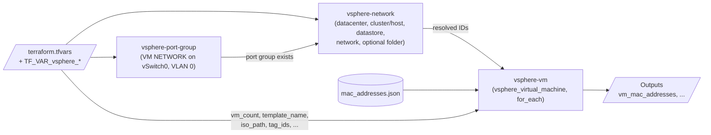
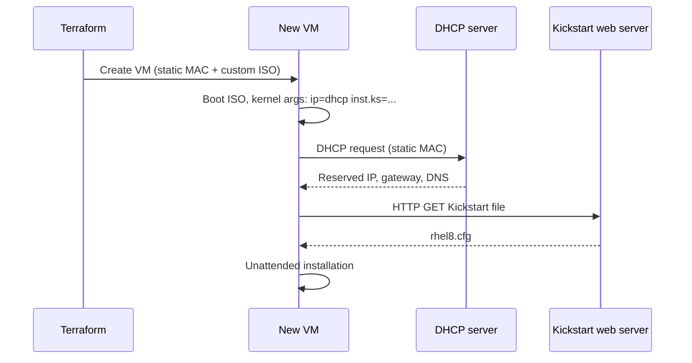

# VMware vSphere VM Provisioning (Terraform)

Modular Terraform project that provisions virtual machines on **VMware vSphere**. It manages the VM port group, looks up shared infrastructure once, and creates VMs with static MAC addresses. VMs can be blank (booted from an ISO, ready for an unattended RHEL Kickstart install) or cloned from a template.


**Technologies:** Terraform, HCL, VMware vSphere, RHEL Kickstart, infrastructure as code.

---

## Table of contents

- [Features](#features)
- [How it works](#how-it-works)
- [Project structure](#project-structure)
- [Modules](#modules)
- [Key design choices](#key-design-choices)
- [Getting started](#getting-started)
- [Importing an existing port group](#importing-an-existing-port-group)
- [Automated RHEL installation with Kickstart](#automated-rhel-installation-with-kickstart)
- [Troubleshooting](#troubleshooting)
- [Possible next steps](#possible-next-steps)

---

## Features

- **Composable modules:** separate modules for the port group, shared infrastructure lookups and compute.
- **Stable VM fleets:** `for_each` keyed by VM name, so removing one VM doesn't recreate the others.
- **Static MAC addresses:** assigned from a JSON file, ready for DHCP reservations.
- **Two build modes:** blank VMs booted from an ISO, or clones of an existing template with hostname customization.
- **Unattended installs:** works with a customized RHEL ISO and Kickstart.
- **Optional inventory folder and tags** applied to every VM.
- **Input validation** that fails fast with a clear message.
- **No credentials in code:** sensitive variables with no defaults.

---

## How it works



1. **`vsphere-port-group`** creates (or verifies) the `VM NETWORK` port group on the ESXi host.
2. **`vsphere-network`** looks up the datacenter, compute cluster or standalone host, datastore and network, and optionally creates an inventory folder.
3. **`vsphere-vm`** takes those resolved IDs and creates the VMs. Each VM gets a static MAC address, and either an ISO or a template clone.

---

## Project structure

```
.
├── main.tf                      # Root: provider + wires port group -> network -> vm modules
├── variables.tf
├── outputs.tf
├── versions.tf
├── terraform.tfvars.example     # Copy to terraform.tfvars (gitignored)
└── modules/
    ├── vsphere-port-group/      # Manages a standard port group on an ESXi host
    ├── vsphere-network/         # Resolves datacenter, cluster/host, datastore, network, folder
    │   ├── data.tf
    │   ├── main.tf              # Optional vsphere_folder
    │   ├── variables.tf
    │   └── outputs.tf
    └── vsphere-vm/              # Pure compute: creates the VMs
        ├── data.tf              # Optional template lookup
        ├── main.tf              # vsphere_virtual_machine, for_each keyed by name
        ├── mac_addresses.json   # Static MAC pool
        ├── variables.tf
        └── outputs.tf
```

---

## Modules

| Module | Responsibility | Notes |
|---|---|---|
| `vsphere-port-group` | Manages the `VM NETWORK` standard port group on `vSwitch0`, VLAN 0 (untagged) | Targets the standalone `esxi_host`, or `port_group_host` when using a cluster. Change `virtual_switch_name`, `vlan_id` or `network_name` to match your environment |
| `vsphere-network` | Resolves shared infrastructure **once**: datacenter, compute cluster or standalone host, datastore, network, optional inventory folder | Exposes `host_system_id`, which you need when importing the port group |
| `vsphere-vm` | Compute only: takes resolved IDs as input and creates VMs | Doesn't do any infrastructure lookups of its own |

### Why split network and compute?

Because `vsphere-vm` only receives IDs, one `vsphere-network` module can feed several VM modules. For example, a `web` group and a `db` group can share the same datastore and network without repeating the data source lookups:

```hcl
module "web" {
  source = "./modules/vsphere-vm"
  # ... IDs from module.network ...
}

module "db" {
  source = "./modules/vsphere-vm"
  # ... same IDs from module.network ...
}
```

### A note on standard port groups

The root module creates or verifies the port group **before** looking up its network ID and passing it to the VMs. Standard port groups are **host-specific**: if VMs may run on, or migrate to, other ESXi hosts, manage a matching port group on every one of those hosts. (A distributed port group on a vDS avoids this, but isn't covered here.)

---

## Key design choices

| Choice | Why |
|---|---|
| **`for_each` instead of `count`** for VMs, keyed by VM name | With `count`, removing VM #3 out of 10 shifts the indexes and makes Terraform destroy and recreate #4–#10. With `for_each`, each VM is tracked by name |
| **Validation on `vm_count`** | Fails fast at `plan` with a clear message instead of a cryptic provider error |
| **Static MACs from `mac_addresses.json`** | Predictable MACs make DHCP reservations and Kickstart installs possible |
| **Optional template cloning** | Leave `template_name` empty for blank VMs (`guest_id` + optional `iso_path`), or set it to clone a template with hostname customization |
| **Optional folder** (`folder_path`) | When set, `vsphere-network` creates the folder and every VM is placed in it |
| **Optional tags** (`tag_ids`) | Pass IDs of existing vSphere tags; they're applied to every VM |
| **Sensitive credentials, no defaults** | Supplied via environment variables or a gitignored file, never committed |

### Static MAC addresses

- The file `modules/vsphere-vm/mac_addresses.json` holds **10 unique addresses** from VMware's static range `00:50:56:80:00:00` – `00:50:56:BF:FF:FF`.
- Addresses are assigned to VMs **in order**.
- `vm_count` **cannot be larger** than the number of addresses in the file. To create more VMs, add more addresses.
- Every address must be unique and must not conflict with anything else in your vSphere environment.
- The assigned addresses are shown in the `vm_mac_addresses` output.

### Build modes

| Mode | Set | Result | Guest networking |
|---|---|---|---|
| Blank VM | `template_name = ""`, `guest_id`, optional `iso_path` | Empty VM that boots from the ISO | Handled by the OS installer / Kickstart |
| Template clone | `template_name = "<template>"` | Clone with hostname customization | Left to the OS (not configured by Terraform) |

---

## Getting started

### Requirements

| Name | Version |
|---|---|
| Terraform | `>= 1.5.0` |
| `hashicorp/vsphere` provider | `~> 2.7` |

You also need:
- A vSphere user with rights to manage host networking, create VMs and folders, and assign tags.
- Network access from the machine running Terraform to vCenter.
- For blank VMs: an ISO uploaded to a datastore. For clones: an existing VM template.

### 1. Configure variables

```bash
cp terraform.tfvars.example terraform.tfvars
```

Replace the example values with your vSphere inventory details (datacenter, host or cluster, datastore, network, VM settings). `terraform.tfvars` is gitignored.

### 2. Supply credentials

Use environment variables, never committed files:

**PowerShell**
```powershell
$env:TF_VAR_vsphere_user     = "your-vsphere-user"
$env:TF_VAR_vsphere_password = "your-vsphere-password"
```

**Bash / zsh**
```bash
export TF_VAR_vsphere_user="your-vsphere-user"
read -rsp "vSphere password: " TF_VAR_vsphere_password && export TF_VAR_vsphere_password
```

> Avoid typing real passwords directly on the command line: they end up in your shell history.

### 3. Import the port group (if it already exists)

If `VM NETWORK` already exists on the host, **import it before the first plan or apply**. See [Importing an existing port group](#importing-an-existing-port-group).

### 4. Deploy

```bash
terraform init
terraform fmt -check
terraform validate
terraform plan -out tfplan
terraform apply tfplan
```

### 5. Check the outputs

```bash
terraform output vm_mac_addresses
```

Use these MACs to create your DHCP reservations (see the Kickstart section).

### Destroy

```bash
terraform destroy
```

> This also deletes the port group if Terraform manages it. Check the plan before confirming, especially if other VMs on the host use `VM NETWORK`.

---

## Importing an existing port group

If `VM NETWORK` already exists and you don't import it, Terraform will try to create a duplicate and fail.

**1. Find the host's managed object ID:**

```bash
terraform init
terraform console
> module.network.host_system_id
"host-<id>"
```

**2. Import the port group using that ID:**

```bash
terraform import "module.port_group.vsphere_host_port_group.vm_network" "tf-HostPortGroup:host-<id>:VM NETWORK"
```

**3. Run `terraform plan`** and confirm it shows no changes (or only the changes you expect) to the port group.

After the import, if someone deletes the port group, a later plan/apply will notice and recreate it with the configured switch and VLAN.

---

## Automated RHEL installation with Kickstart

### Overview



### Before you start

- [ ] A **DHCP reservation** exists for each VM's MAC address, with the intended IP, gateway and DNS.
- [ ] A **web server** reachable from the installation network serves the Kickstart file over HTTP.
- [ ] You have **verified the Kickstart URL** (for example with `curl`) from that network.

### Step 1: Customize the ISO

To make the installer fetch the Kickstart file automatically, add the Kickstart URL to the kernel boot arguments on the ISO.

1. Make a working copy of the RHEL ISO and extract its contents.
2. Open the boot menu config:
   - **UEFI:** `EFI/BOOT/grub.cfg`
   - **Legacy BIOS:** `isolinux/isolinux.cfg`
3. Find the boot entry's **kernel line**: it starts with `linuxefi` (UEFI GRUB) or `linux` / `append` (BIOS). Add these arguments to the end of that line:

   ```
   ip=dhcp inst.ks=http://kickstart.example.test/my-kickstart-file/rhel8.cfg
   ```

   A UEFI entry then looks like this. Keep the existing arguments and only add the two new ones:

   ```
   menuentry 'Install Red Hat Enterprise Linux 8' {
       linuxefi /images/pxeboot/vmlinuz inst.stage2=hd:LABEL=RHEL-8-x86_64-dvd ip=dhcp inst.ks=http://kickstart.example.test/my-kickstart-file/rhel8.cfg
       initrdefi /images/pxeboot/initrd.img
   }
   ```

   > ⚠️ The arguments go on the **`linuxefi` / `linux` (kernel) line**, not the `initrdefi` / `initrd` line. Keep the paths and volume label your ISO already uses; labels differ between releases.

4. Rebuild the ISO as a bootable image, keeping both BIOS and UEFI boot support.
5. Upload the customized ISO to the vSphere datastore.

> 💡 **Shortcut:** on a RHEL or Fedora machine, the `mkksiso` tool (from the `lorax` package) can add kernel arguments or embed a Kickstart file and rebuild a bootable ISO in one command. Run `mkksiso --help` for the options in your version.

### Step 2: Provision the VMs

1. Set `iso_path` in `terraform.tfvars` to the customized ISO's datastore path.
2. Run `terraform plan` and `terraform apply`.
3. Make sure the MAC-to-IP reservations are active.

On boot, each VM gets its reserved address by DHCP, downloads the Kickstart file and runs the unattended installation.

> Replace `kickstart.example.test` with a hostname reachable from the installation network. Test with one VM before provisioning many.

---

## Troubleshooting

| Symptom | Likely cause | Fix |
|---|---|---|
| Apply fails: port group already exists | `VM NETWORK` wasn't imported | [Import it](#importing-an-existing-port-group), then plan again |
| Plan fails on `vm_count` validation | Value is out of range, or larger than the MAC pool | Lower `vm_count` or add addresses to `mac_addresses.json` |
| VM can't connect after migrating to another host | Standard port group exists only on the original host | Create a matching port group on every host the VM can run on |
| Installer drops to the manual GUI or a dracut shell | Kickstart URL unreachable, or arguments on the wrong line | Check the args are on the kernel line; test the URL from the install network |
| VM gets no IP address during install | DHCP reservation missing or MAC mismatch | Compare `terraform output vm_mac_addresses` with the DHCP reservations |
| ISO won't boot | Rebuild lost the BIOS or UEFI boot settings | Rebuild keeping both boot catalogs, or use `mkksiso` |
| MAC address conflict | Another VM already uses an address from the pool | Choose unused addresses in `mac_addresses.json` |
| Template lookup fails | `template_name` doesn't match an existing template | Check the exact name in vCenter, or set it to `""` for blank VMs |

---

## Possible next steps

- [ ] Split tagging into its own `modules/vsphere-tags` module, so tag categories and tags are managed in code instead of passed in as existing IDs.
- [ ] Add `terraform test` (native since Terraform 1.6) to cover the validation logic without touching real infrastructure.
- [ ] Move state to a remote backend with locking (Terraform Cloud, or S3 + DynamoDB) before several people work on this.
- [ ] Support distributed port groups (vDS), so VMs can move between hosts without per-host port groups.
- [ ] Generate MAC addresses in code instead of keeping a static file.
